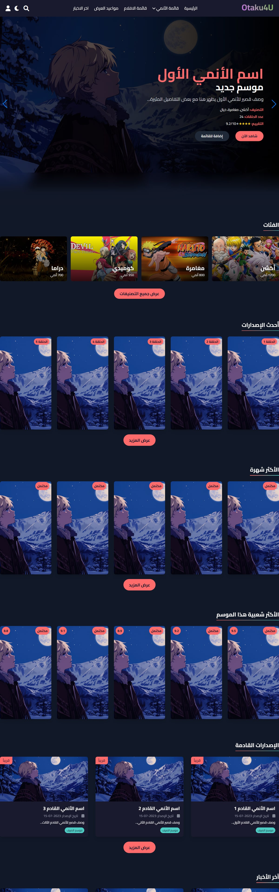
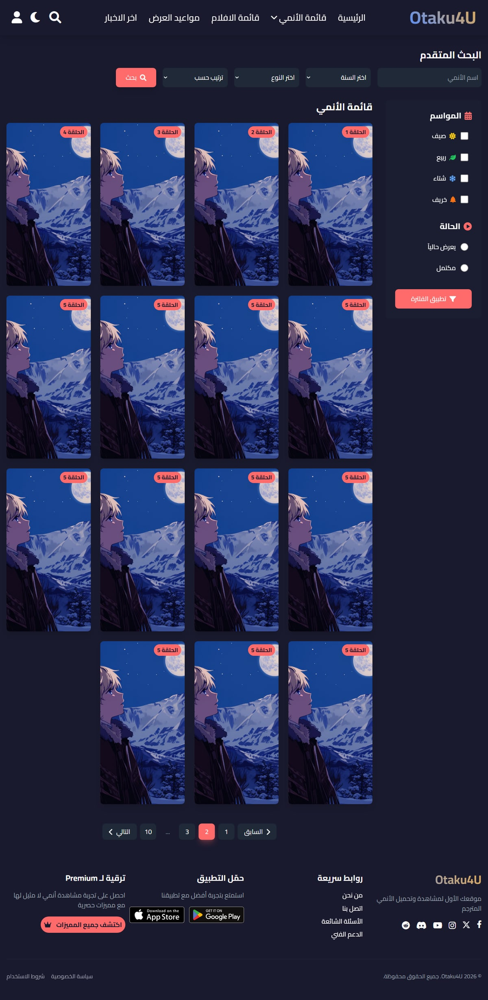
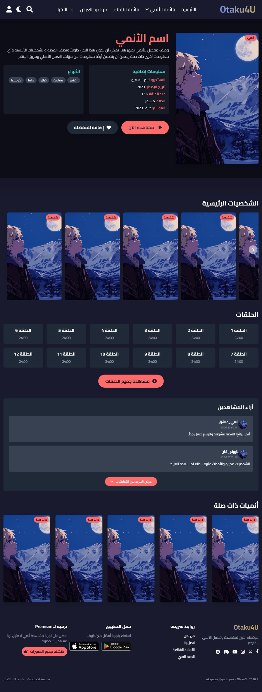
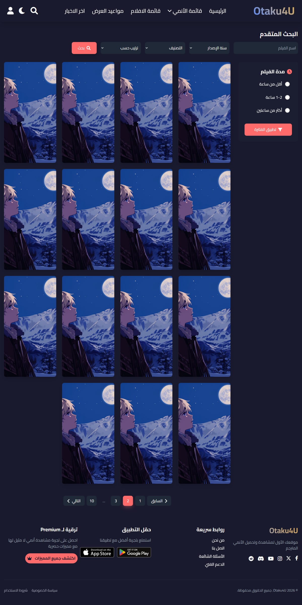
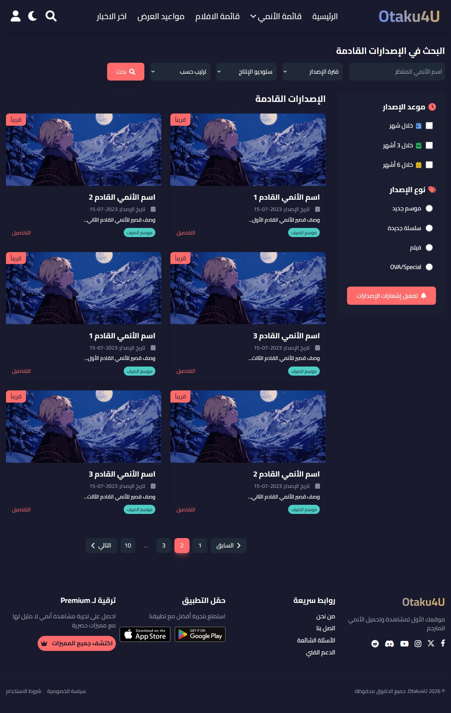
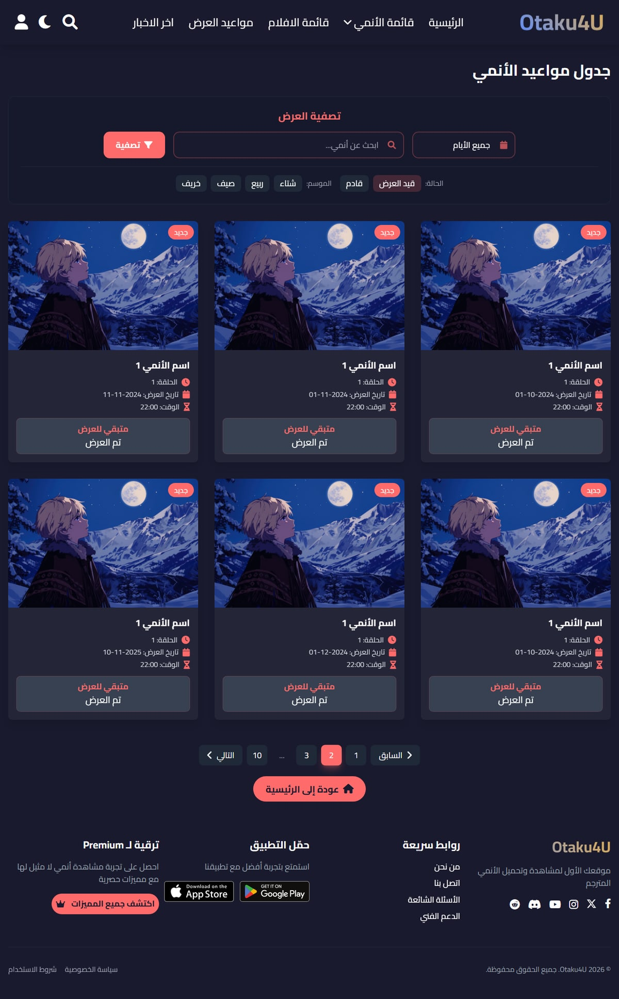
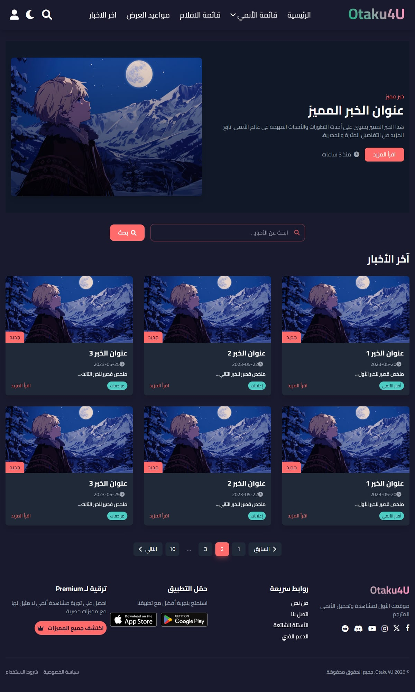
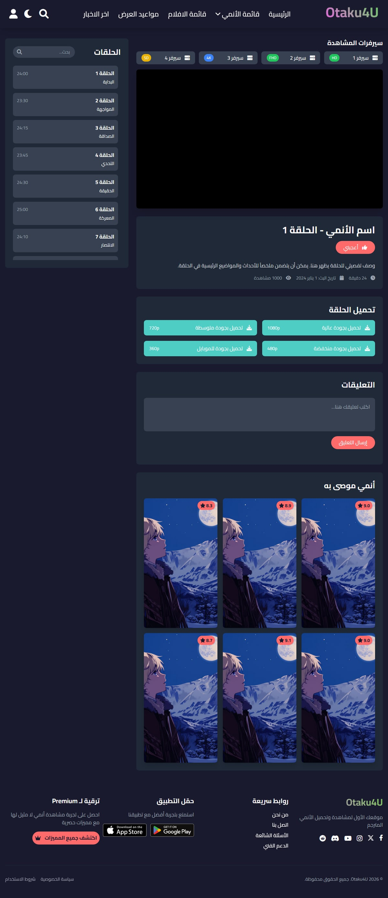
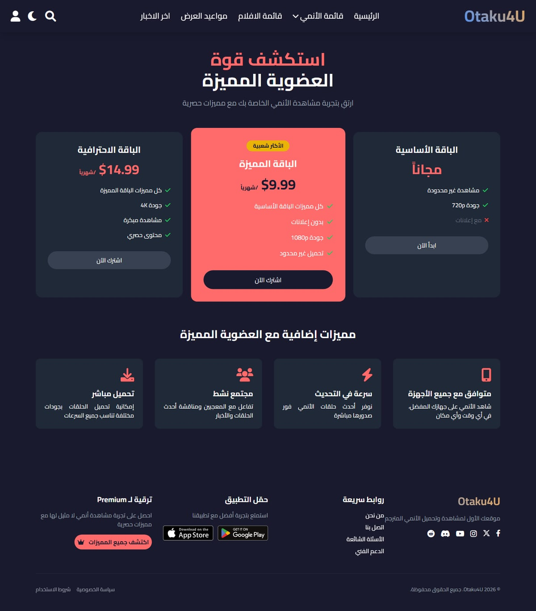
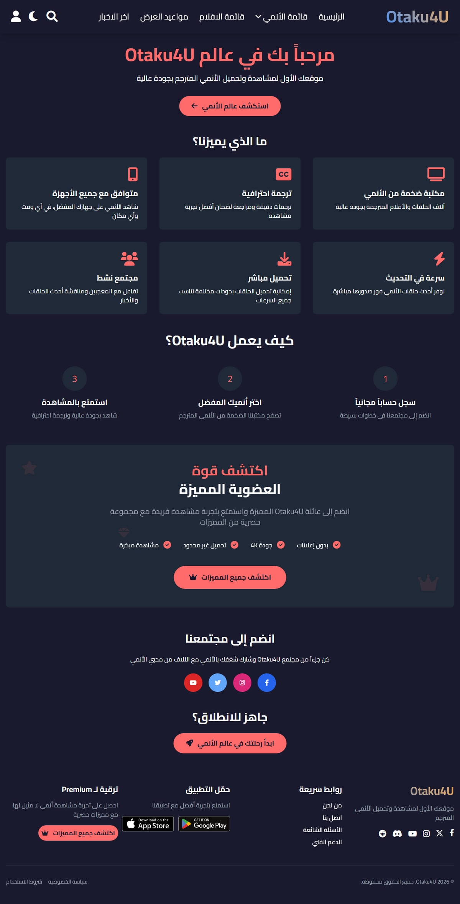

# Otaku4U — Anime Portal

A fully responsive, right-to-left Arabic anime portal built with plain HTML, CSS and
vanilla JavaScript. Otaku4U covers everything an anime fan needs in one place: airing
shows, upcoming releases, movies, weekly broadcast schedules, news and a personal
watchlist, wrapped in a dark, modern interface.


---

## Table of Contents

- [Overview](#overview)
- [Screenshots](#screenshots)
- [Features](#features)
- [Project Structure](#project-structure)
- [Tech Stack](#tech-stack)
- [Getting Started](#getting-started)
- [Pages](#pages)
- [Design Tokens](#design-tokens)
- [License](#license)

---

## Overview

Otaku4U is a static, multi-page front-end for an anime streaming portal. Every route
shares a single header and footer component, a common Tailwind design-token
configuration and a consistent RTL layout, so the whole site feels like one product.

The project was restructured from a single-file prototype into a modular layout:
markup, styles and scripts live in separate files, page-level assets are isolated per
route, and nothing is inlined in the HTML.

---

## Screenshots

| Home | Anime list | Anime details |
| :---: | :---: | :---: |
| [](screenshots/home.jpg) | [](screenshots/anime-list.jpg) | [](screenshots/anime-details.jpg) |

| Movies | Upcoming releases | Broadcast schedule |
| :---: | :---: | :---: |
| [](screenshots/movies.jpg) | [](screenshots/upcoming.jpg) | [](screenshots/schedule.jpg) |

| News | Watchlist | Premium |
| :---: | :---: | :---: |
| [](screenshots/news.jpg) | [](screenshots/watchlist.jpg) | [](screenshots/premium.jpg) |

| Welcome | | |
| :---: | :---: | :---: |
| [](screenshots/welcome.jpg) | | |

---

## Features

- **Fully RTL Arabic interface** (`lang="ar" dir="rtl"`) with the Cairo typeface.
- **Shared header and footer** injected into all 13 pages for a consistent shell.
- **Sticky navigation** with a dropdown anime menu, search, dark-mode toggle and an
  account menu with sign-in / sign-up / password-recovery modals.
- **Hero carousel** on the home page powered by Swiper (fade effect, autoplay and
  custom active/inactive slide styling).
- **Scroll-triggered animations** using `IntersectionObserver` for staggered content
  reveals, plus AOS on the About page.
- **Back-to-top control** that appears once the user scrolls past the hero section.
- **Category browsing** with an expand/collapse "show more" control.
- **Mobile-first responsiveness** with a dedicated slide-out mobile menu.

---

## Project Structure

```text
otaku4u-anime-portal/
├── .github/
│   ├── ISSUE_TEMPLATE/
│   │   ├── bug_report.yml
│   │   ├── config.yml
│   │   └── feature_request.yml
│   ├── PULL_REQUEST_TEMPLATE.md
│   └── workflows/
│       └── deploy-pages.yml
├── assets/
│   ├── css/
│   │   ├── base.css            # Fonts, resets and shared utilities
│   │   ├── layout.css          # Header, footer, nav, modals
│   │   └── pages/              # One stylesheet per route
│   ├── images/                 # Covers, category art and branding
│   └── js/
│       ├── footer.js           # Footer behaviour (dynamic year)
│       ├── header.js           # Navigation, search, auth modals, dark mode
│       ├── tailwind.config.js  # Shared design tokens
│       └── pages/              # One script per route
├── components/
│   ├── footer.html             # Shared footer component preview
│   └── header.html             # Shared header component preview
├── pages/                      # All secondary routes
├── screenshots/                # Page previews used in this README
├── index.html                  # Home page
├── CHANGELOG.md
├── CODE_OF_CONDUCT.md
├── CONTRIBUTING.md
├── LICENSE
└── README.md
```

---

## Tech Stack

| Layer        | Technology                                                            |
| ------------ | --------------------------------------------------------------------- |
| Markup       | Semantic HTML5                                                        |
| Styling      | [Tailwind CSS](https://tailwindcss.com/) (CDN) + hand-written CSS      |
| Scripting    | Vanilla JavaScript (ES6+)                                             |
| Carousel     | [Swiper](https://swiperjs.com/)                                        |
| Scroll anims | [AOS](https://michalsnik.github.io/aos/) + `IntersectionObserver`      |
| Icons        | [Font Awesome 6](https://fontawesome.com/)                            |
| Typography   | [Cairo](https://fonts.google.com/specimen/Cairo) (Google Fonts)        |

---

## Getting Started

No build step and no dependencies are required — the site is fully static.

### Run locally

Clone the repository and open `index.html` in a browser, or serve the folder with any
static server so that relative asset paths resolve exactly as they would in production:

```bash
git clone <repository-url>
cd otaku4u-anime-portal
python -m http.server 8080
```

Then visit <http://localhost:8080>.

Any equivalent static server works, for example:

```bash
npx serve .
```

### Deployment

A GitHub Actions workflow (`.github/workflows/deploy-pages.yml`) publishes the static
site to **GitHub Pages** on every push to `main` (and can also be triggered manually
from the Actions tab). Enable *Settings → Pages → Build and deployment → Source:
GitHub Actions* once in the repository settings.

---

## Pages

| Route                       | Title                          | Description                                             |
| --------------------------- | ------------------------------ | ------------------------------------------------------- |
| `index.html`                | الرئيسية                       | Hero carousel, trending, categories and latest news     |
| `pages/anime-list.html`     | قائمة الأنمي                   | Currently airing anime with search and filters          |
| `pages/upcoming.html`       | الإصدارات القادمة              | Upcoming releases sorted by date                        |
| `pages/movies.html`         | قائمة الأفلام                  | Anime movies catalogue                                  |
| `pages/schedule.html`       | مواعيد العرض                   | Weekly broadcast schedule                               |
| `pages/news.html`           | آخر الأخبار                    | News feed with expandable articles                      |
| `pages/anime-details.html`  | معلومات الأنمي                 | Series details, episodes and related titles             |
| `pages/watchlist.html`      | مشاهدة الأنمي                  | Personal watchlist                                      |
| `pages/premium.html`        | استكشف مميزاتنا                | Premium plan benefits                                   |
| `pages/about.html`          | من نحن                         | About the project and team                              |
| `pages/contact.html`        | اتصل بنا                       | Contact form and channels                               |
| `pages/privacy.html`        | سياسة الخصوصية                 | Privacy policy                                          |
| `pages/welcome.html`        | مرحباً بك                      | Onboarding / welcome page                               |

---

## Design Tokens

Shared across every page through `assets/js/tailwind.config.js`:

| Token        | Value     | Usage                          |
| ------------ | --------- | ------------------------------ |
| `primary`    | `#FF6B6B` | Accents, links, highlights     |
| `secondary`  | `#4ECDC4` | Secondary accents and badges   |
| `background` | `#1A1A2E` | Page background                |
| `text`       | `#FFFFFF` | Body copy                      |
| `fontFamily` | `Cairo`   | Global typeface                |

Using these tokens keeps colours and typography consistent — change a value once and
the entire site follows.

---

## Contributing

Contributions are welcome. Please read [CONTRIBUTING.md](CONTRIBUTING.md) and follow the
[Code of Conduct](CODE_OF_CONDUCT.md). Commit messages follow the
[Conventional Commits](https://www.conventionalcommits.org/) specification, and notable
changes are recorded in [CHANGELOG.md](CHANGELOG.md).

---

## License

Released under the [MIT License](LICENSE).
